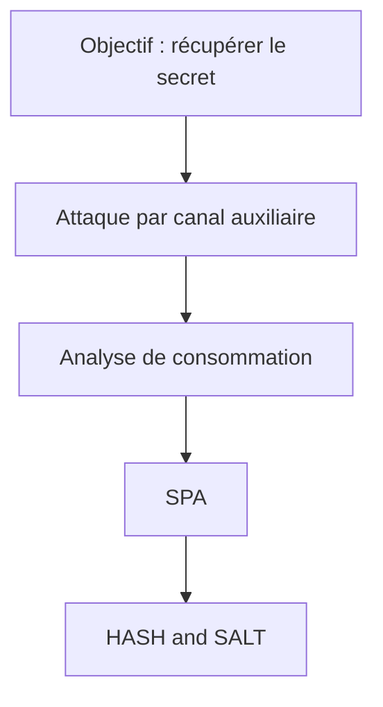

# School_project_arduino_vuln_write_up
 

## SUMMARY
 
1. [Hardware](#hardware)
2. [Asset description](#asset-description)
3. [Attack tree](#attack-tree)
4. [Vulnerability severity assessment](#vulnerability-severity-assessment)
5. [Attack(s) description and implementation](#attacks-description-and-implementation)
6. [Proposed counter-measure(s)](#proposed-counter-measures)
7. [Références](#références)
   
---
 
## Hardware
 
### Target 
 
| Elements | Specifications |
|---|---|
| Board | Arduino UNO |
| µC |  ATmega328P |
| Entry point | UART, USB |
 
### Tools used
 
| Tool  | Goal | Software |
|---|---|---|
| Logic analyzer | Measure all informations transit between the exterior and the interior of the board | Pulseview |
| Chipwhisperer board CWNANO edition | Specialized board to try multiples hardware attack (in this case I've used CPA) | Chipwhisperer Software suite |
 
### Montage
 

 

 
---
 
## Asset description

| Asset | Location | Confidentiality |
|---|---|---|
|key entry location | in one of the entry point | medium as limited by the number of interface |
| Keys | in the µC | high |

The key will let us get into the main architecture. In theory the key hold the most value, nonetheless if the firmware is known and not carefully hash we can use LLMS or other tools to decrypt it making all this attack meaningless.
 
---
 
## Attack tree
 
Objectif de l'attaquant : **This write-up is educational so the goal is just to get into the arduino and obtain one salt and one hash.**
 

 
## Vulnerability-Severity-Assessment 

Using online calculator we can see the CVSS V4.0 score of the potential vulnerability is 7.2. The Consequences are quite variable depending of the type of machine we get into even so this a proof of concept, the ease of use the exploit make this number high.

To obtain this number, I've used this site : https://nvd.nist.gov/vuln-metrics/cvss/v4-calculator, and considered this : CVSS:4.0/AV:P/AC:L/AT:N/PR:N/UI:N/VC:H/VI:H/VA:N/SC:H/SI:H/SA:N/E:P/MAV:P/MAC:L/MAT:N/MPR:N/MUI:N/MVC:H/MVI:H/MVA:H/R:U/V:D/RE:M   feel free to see for yourself and discuss it if you disagree.

---
 
## Attack(s) description and implementation
 
### _Simple power analysis_
 
**Requirements** : _physical entry point , microC specialized device like chipwhisperer_
 
#### Principle
 

The simple power analysis goal is to first caractherize the system. By using the montage shown, we can using the chipwhisperer board sample a lot of imformation from the µC. Doing so we can obtain the orange trace over the next picture revealing a little of the internal functionning. By hypothesis we can assume that the verification will occur at the peak between 1600 - 1900 and check for multiple password check the hypothesis. The blue trace is a password check with the first letter correct (given as hint by our instructor). We can see that the behavior of the trace do not change  but get a less high peak at our hypothethical verification moment, meaning the code react to it, meaning multiple thing like : early-exit or hamming weight correlation or whatever. This peak will act as our **leak**.

 

## Proposed counter-measure

## Reference

 
