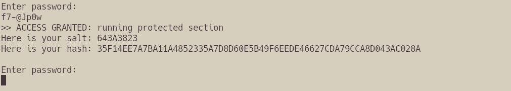
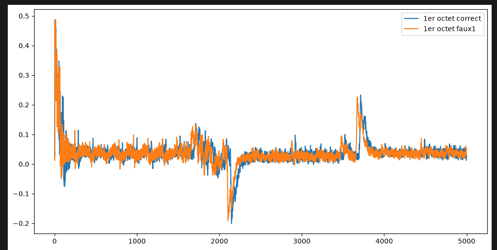
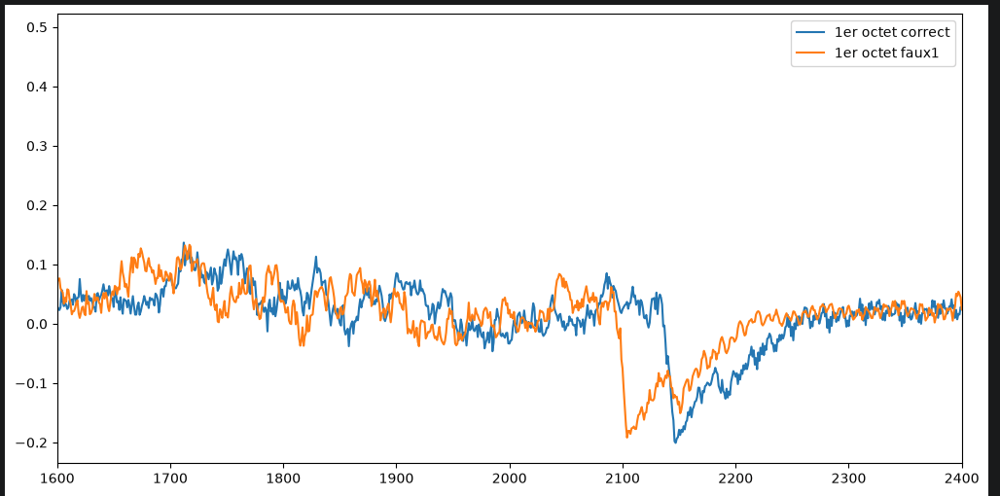
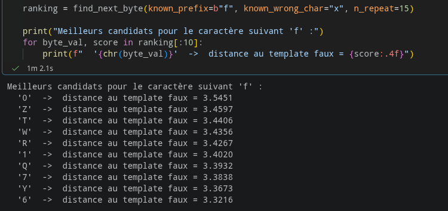
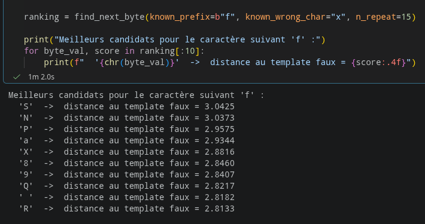
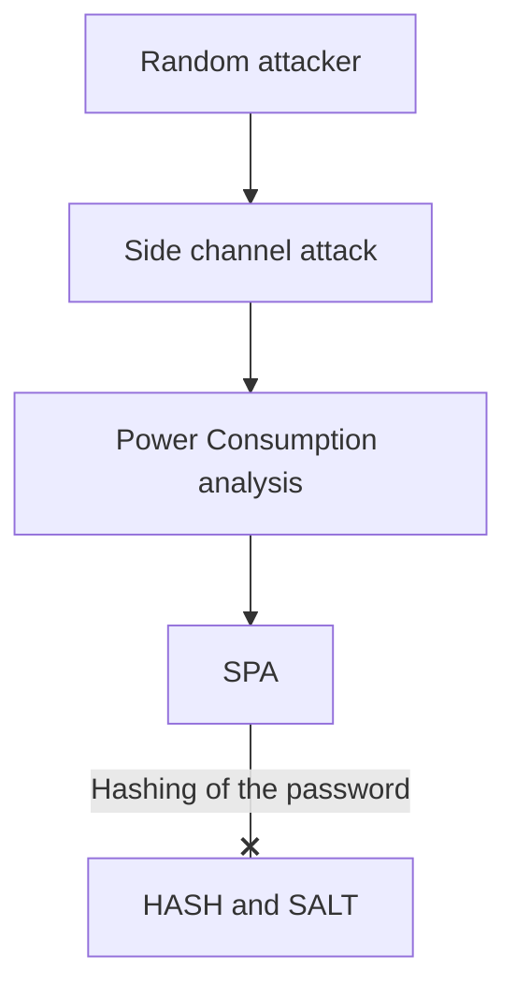

# School_project_arduino_vuln_write_up
 

## SUMMARY
 
1. [Hardware](#hardware)
2. [Attack(s) description and implementation](#attacks-description-and-implementation)
3. [Code usage](#code-usage)
4. [Proposed counter-measure](#Proposed-counter-measure)
5. [Asset description](#asset-description)
6. [Attack tree](#attack-tree)
7. [Vulnerability severity assessment](#vulnerability-severity-assessment)
8. [References](#references)
   
---
 
## Hardware
 
### Target 
 
| Elements | Specifications |
|---|---|
| Board | Arduino UNO |
| µC |  ATmega328P |
| Entry point | UART, USB |
 
### Tools used
 
| Tool  | Goal | Software |
|---|---|---|
| Logic analyzer | Measure all informations transit between the exterior and the interior of the board | Pulseview |
| Chipwhisperer board CWNANO edition | Specialized board to try multiples hardware attack (in this case I've used SPA) | Chipwhisperer Software suite |
 
### Montage
 

The setup shown above serves several purposes. First, it allows the microcontroller (µC) to be moved to the breadboard, enabling direct connections to pins 16 and 17, which function here as RX and TX. Pin 7 can be used by the ChipWhisperer module by connecting a shunt to allow displaying of power measurements (It need to be connected to the middle pin of the little cluster named "measure" on the Chipwhisperer board). Pin 19 of the microcontroller is used to generate the trigger signals required by pin 16 of the ChipWhisperer module. Pin 16 on the module is the dedicated trigger input, and pin 19 on the microcontroller corresponds to pin 13 on the Arduino Uno ( mapping identified using a logic analyzer, which was also used to determine that pins 16 and 17 are for the UART connection). These pin assignments were left unchanged to avoid potential issues with the code. The remainder of the setup is required to power the various modules, and the capacitor values ​​were determined based on this GitHub repository: https://github.com/parastuffs/Embedded-Security/wiki/Connecting-to-an-external-target.

This setup will not be altered during the exploit, as it is entirely sufficient for the task.
 
 The only change over the chipwhisperer board have been to desolder the pad next to the STM32F0 to reduce measurement noises.

 
---

 
## Attack(s) description and implementation
 
### _Simple power analysis_
 
**Requirements** : _physical entry point , microC specialized device like chipwhisperer_
 
#### Principle
 

By using the montage shown above, we can, using the chipwhisperer board, sample a lot of imformation from the µC. Doing so, we can obtain the orange trace over the next picture revealing a little of the internal functionning. By hypothesis, we can assume that the verification will occur at the peak between 1600 - 1900 and check for multiple passwords. The blue trace is a password check with the first letter correct (given as hint by our instructor). We can see that the behavior of the trace do not change  but get a less high peak at our hypothethical verification moment, meaning the code react to it, meaning multiple thing like : early-exit or hamming weight correlation or whatever. This peak will act as our **leak**.

A little zoom over the leak : 

Using the file testSPAfinal.ipynb, we can sample several traces and calculate their average value for a known character. It allow us to compare multiple mean power between them, And by choosing a reference (a trace made by sending a character we know will never be in the password ) we can obtain a list of the most distant trace in our interesting interval which by extension will show us if a character is different from other, and by hypothesis a character in the password. As we choose our reference as the 100% wrong character. 

By doing that, we can totally and accurately break the password by executing the code multiple code over itself as the code will find byte one by one. 

---

## Code usage

To implement the attack, I've first used the trigger_test.ipynb file. Using simple chipwhisperer function like scope.write() and scope.capture() we can write things to the target and obtain the power response from it. I've used a basic configuration with scope.default_setup() and a baudrate of 9600. This file as you would have guessed is just to see if the chipwhisperer see the trigger activation when we enter a password.

Next to define the timing of the leak, I've used the POI_test.ipynb file to test lot of inputs to obtain a good approximation of the power response shape. By sending multiples good and bad input just like the trigger_test file we can do that. A little delay over the scope with time.sleep(0.1) or 0.05 is neccessary as the scope has the bad habit of timing out (surely cause of the noise induced by the breadboard). With plt.xlim() we can zoom over the POI, point of interest, over the trace (our leak as explained).
A little funny thing observed have been the fact the two trace are dephased by a little, maybe its cause of the internal functionning of the chipwhisperer but as of now I'm not really sure.

The testSPAfinal.ipynb is the file where we will try to anticipate the next byte of the password. Using the POI area we've found just before we can reduce the noise over the mean value of the trace that we compute using the same method as above. The find_next_byte method goal is to create a fake template based over a character we know isn't in the password. This fake template will act like a reference of the most bad character that we could have guess. So by computing the distance between the mean value of the bad template and the mean value of any other character template we can get an accurate prediction of the next character of the password. The precision is quite good as over multiple try, the character has always been the correct meaning the setup is quite robust for this case.

---

## Proposed counter-measure

To counter this exploit we can do lots of things, in this case I will just hash the password and add noise over the power analysis. As now each mean values balance out.

Alternatives we could also not use any early exit code to change the behavior of the code erasing of displacing the leak point.

The result of this counter-measure : 

We see here that the general distance also increase. (The noise introduced as explained)

---

 
## Asset description

| Asset | Location | Confidentiality |
|---|---|---|
|key entry location | in one of the entry point | medium as limited by the number of interface |
| Keys | in the µC | high |

The key will let us get into the main architecture. In theory the key hold the most value, nonetheless if the firmware is known and not carefully hash we can use LLMS or other tools to decrypt it making all this attack meaningless.
 
---

## Attack tree
 
 

---
 
## Vulnerability-Severity-Assessment 

Using online calculator we can see the CVSS V4.0 score of the potential vulnerability is 7.2. The Consequences are quite variable depending of the type of machine we get into, even so, this is a proof of concept, the ease of use of this exploit make this number high.

To obtain this number, I've used this site : https://nvd.nist.gov/vuln-metrics/cvss/v4-calculator, and considered this : CVSS:4.0/AV:P/AC:L/AT:N/PR:N/UI:N/VC:H/VI:H/VA:N/SC:H/SI:H/SA:N/E:P/MAV:P/MAC:L/MAT:N/MPR:N/MUI:N/MVC:H/MVI:H/MVA:H/R:U/V:D/RE:M   feel free to see for yourself and discuss it if you disagree.

---

## References

- https://github.com/parastuffs/Embedded-Security/wiki/Connecting-to-an-external-target
- https://chipwhisperer.readthedocs.io/en/latest/Capture/20-pin-connector.html
- https://solderingmind.com/atmega328/
  

 
