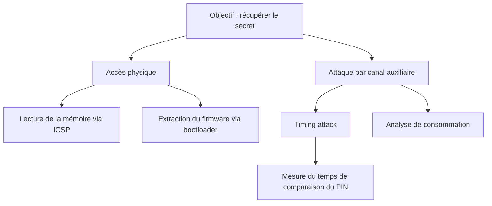

# School_project_arduino_vuln_write_up
 

## SUMMARY
 
1. [Hardware](#hardware)
2. [Asset description](#asset-description)
3. [Attack tree](#attack-tree)
4. [Vulnerability severity assessment](#vulnerability-severity-assessment)
5. [Attack(s) description and implementation](#attacks-description-and-implementation)
6. [Proposed counter-measure(s)](#proposed-counter-measures)
7. [Références](#références)
---
 
## Hardware
 
### Target 
 
| Elements | Specifications |
|---|---|
| Board | Arduino UNO |
| µC |  ATmega328P |
| Entry point | UART, USB |
 
### Tools used
 
| Tool  | Goal | Software |
|---|---|---|
| Logic analyzer | Measure all informations transit between the exterior and the interior of the board | Pulseview |
| Chipwhisperer board CWNANO edition | Specialized board to try multiples hardware attack (in this case I've used CPA) | Chipwhisperer Software suite |
 
### Montage
 

 

 
---
 
## Asset description

| Asset | Localisation | Confidentialité |
|---|---|---|
|key entry location | in one of the entry point | medium as limited by the number of interface |
| Keys | in the µC | high |

The key will let us get into the main architecture. In theory the key hold the most value, nonetheless if the firmware is known and not carefully hash we can use LLMS or other tools to decrypt it making all this attack meaningless.
 
---
 
## Attack tree
 
Objectif de l'attaquant : **This write-up is educational so the goal is just to get into the arduino and obtain one salt and one hash.**
 

 
## vulnerability-severity-assessment 

Using online calculator we can see the CVSS V4.0 score of the potential vulnerability is ~1.9/2. The Consequences are quite variable depending of the type of machine we get into but as the method to epxloit that vulnerability are already documented the score is not so high.

## attacks-description-and-implementation 
 
